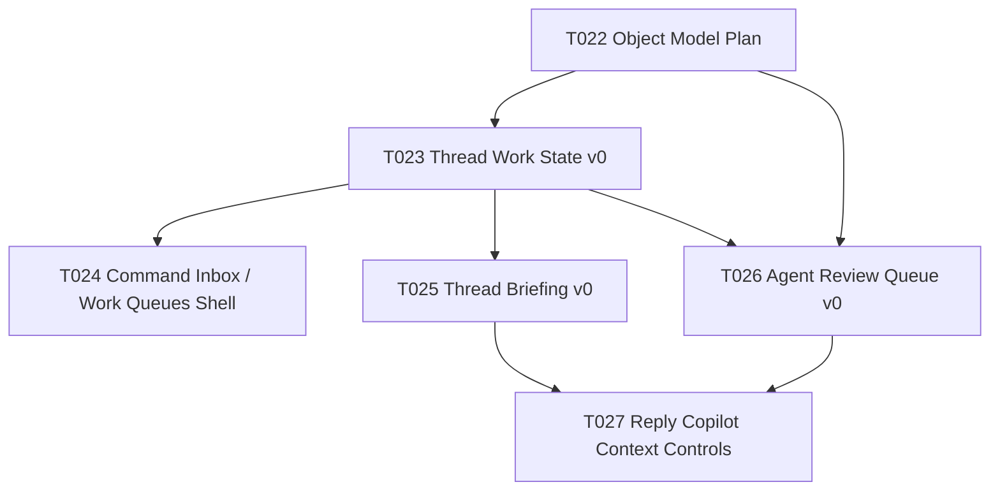

# Agentic Object Model 与数据计划

## 元数据

- 阶段：Stage 3B
- 状态：Ready_For_User_Review
- 日期：2026-06-01
- 范围：Agentic Inbox 核心对象模型、SQLite schema 计划、service API、风险边界、测试计划
- 非范围：不实现 migration，不改 UI，不接入 AI 自动写入，不改变邮件同步行为

## 1. 直接判断

下一步必须先建对象模型，不应该先改 Sidebar 或 ThreadView。

原因很简单：没有稳定的 `ThreadWorkState` 和 `AgentAction`，任何 Work Queue、Thread Briefing、Agent Review Queue 都只是 UI 假壳。用户看到的会是“看起来像 Agentic Inbox”，但底层仍是普通邮箱状态和 AI 小组件。

Stage 3B 的目标不是把模型设计到完美，而是给第一版实现一个足够小、足够硬的骨架：

- 每个线程有明确主工作状态。
- Agent 的建议和准备动作有统一生命周期。
- 承诺、等待、决策从普通任务里分出来。
- AI 可以提出候选，但不能默认替用户承诺或执行高风险动作。
- 所有对象 local-first，存 SQLite，可测试、可审计、可撤销。

## 2. 设计原则

### 2.1 不污染 `threads`

不要把 `needs_reply`、`waiting`、`decision_needed` 等字段直接塞进 `threads` 表。

`threads` 是邮件同步基础表，应尽量保持接近 provider-neutral mail model。Agentic Inbox 是 Kirje 的工作状态层，应该独立建表，引用 `(account_id, thread_id)`。

### 2.2 不复用 `tasks` 承载一切

现有 `tasks` 表适合泛任务，不适合作为 Commitment / Waiting / Decision 的唯一承载。

承诺、等待、决策是邮件沟通对象，不是普通 Todo。它们需要来源消息、确认状态、confidence、risk、relationship context 和 Agent review 关联。

### 2.3 AI 输出先进入草案层

Agent 可以观察和建议，但正式对象默认必须经用户确认：

- AI 提取的承诺：先是 `proposed`。
- AI 推断的 waiting：先是 `proposed` 或 `suggested` AgentAction。
- AI 准备的回复：先是 prepared AgentAction，不直接发送。

### 2.4 一个 primary state，多种辅助 signal

线程列表必须清晰。一个线程同时显示 5 个主状态会制造噪音。

规则：

- `ThreadWorkState.primary_state` 同一时间只有一个。
- risk、priority、has_agent_action、has_due、has_waiting 等作为辅助字段或派生 signal。
- UI 默认按 primary state 进入队列。

### 2.5 可审计优先于自动化

AgentAction 是产品信任层。所有会改变用户状态、邮件状态或对外沟通的 Agent 建议，都应可追踪：

- 来源是什么。
- 建议内容是什么。
- 谁确认了。
- 何时执行。
- 失败原因是什么。

## 3. 与现有 Velo/Kirje 数据的关系

| 现有对象 | 处理方式 | 判断 |
| --- | --- | --- |
| `threads` | 引用，不扩字段 | 邮件同步基础表，不承载 Agentic primary state。 |
| `messages` | 引用 source message | 用于 source evidence 和 briefing source hash。 |
| `contacts` | 引用 contact id 或 email | 后续 Relationship Memory 的基础。 |
| `tasks` | 可从 Commitment 派生任务，但不作为第一承载 | 避免把邮箱做成任务管理器。 |
| `follow_up_reminders` | 保留手动提醒；Waiting v0 不直接替换 | 后续可以桥接，但不能先破坏已有提醒。 |
| `ai_cache` | 保留通用 cache；BriefingSnapshot 独立 | `ai_cache` 是原始 AI 结果缓存，不是产品对象。 |
| `pending_operations` | Agent Act 未来执行邮件动作时必须复用 | 不在 Stage 3B 改。 |
| `quick_steps` | 后续可演进成 Rules / Playbooks | 第一版不绑定。 |

## 4. SQLite Schema 计划

预计新增 migration `version: 24`，描述建议为：

`Add Agentic Inbox work states and reviewable agent actions`

### 4.1 `thread_work_states`

用途：线程的主工作状态和排序信号。

```sql
CREATE TABLE IF NOT EXISTS thread_work_states (
  account_id TEXT NOT NULL,
  thread_id TEXT NOT NULL,
  primary_state TEXT NOT NULL DEFAULT 'unclassified',
  priority TEXT NOT NULL DEFAULT 'normal',
  risk_level TEXT NOT NULL DEFAULT 'low',
  source TEXT NOT NULL DEFAULT 'manual',
  confidence REAL,
  due_at INTEGER,
  waiting_since INTEGER,
  last_reviewed_at INTEGER,
  completed_at INTEGER,
  archived_by_state_at INTEGER,
  note TEXT,
  created_at INTEGER DEFAULT (unixepoch()),
  updated_at INTEGER DEFAULT (unixepoch()),
  PRIMARY KEY (account_id, thread_id),
  FOREIGN KEY (account_id, thread_id) REFERENCES threads(account_id, id) ON DELETE CASCADE
);
CREATE INDEX IF NOT EXISTS idx_thread_work_states_state
  ON thread_work_states(account_id, primary_state, due_at, updated_at);
CREATE INDEX IF NOT EXISTS idx_thread_work_states_priority
  ON thread_work_states(account_id, risk_level, priority, due_at);
```

Allowed `primary_state`：

- `unclassified`
- `needs_reply`
- `waiting`
- `committed`
- `decision_needed`
- `risk`
- `opportunity`
- `can_archive`
- `done`

Allowed `priority`：

- `low`
- `normal`
- `high`
- `urgent`

Allowed `risk_level`：

- `low`
- `medium`
- `high`

Allowed `source`：

- `manual`
- `rule`
- `agent_suggested`
- `agent_approved`
- `system`

产品规则：

- `agent_suggested` 不应自动覆盖用户手动设置。
- 用户手动状态优先级高于规则和 AI。
- `done` 不等于邮件归档。是否归档是单独动作。

### 4.2 `agent_actions`

用途：统一记录 Agent 建议、准备和执行过的动作。

```sql
CREATE TABLE IF NOT EXISTS agent_actions (
  id TEXT PRIMARY KEY,
  account_id TEXT NOT NULL,
  thread_id TEXT,
  message_id TEXT,
  kind TEXT NOT NULL,
  level TEXT NOT NULL,
  status TEXT NOT NULL,
  risk_level TEXT NOT NULL DEFAULT 'low',
  title TEXT NOT NULL,
  summary TEXT,
  payload_json TEXT NOT NULL DEFAULT '{}',
  source_refs_json TEXT NOT NULL DEFAULT '[]',
  result_json TEXT,
  error TEXT,
  created_by TEXT NOT NULL DEFAULT 'agent',
  reviewed_by TEXT,
  created_at INTEGER DEFAULT (unixepoch()),
  reviewed_at INTEGER,
  executed_at INTEGER,
  expires_at INTEGER,
  FOREIGN KEY (account_id, thread_id) REFERENCES threads(account_id, id) ON DELETE CASCADE,
  FOREIGN KEY (account_id, message_id) REFERENCES messages(account_id, id) ON DELETE SET NULL
);
CREATE INDEX IF NOT EXISTS idx_agent_actions_review
  ON agent_actions(account_id, status, risk_level, created_at DESC);
CREATE INDEX IF NOT EXISTS idx_agent_actions_thread
  ON agent_actions(account_id, thread_id, status);
CREATE INDEX IF NOT EXISTS idx_agent_actions_kind
  ON agent_actions(account_id, kind, status);
```

Allowed `level`：

- `observe`
- `suggest`
- `prepare`
- `act`

Allowed `status`：

- `suggested`
- `prepared`
- `approved`
- `rejected`
- `executed`
- `failed`
- `expired`

Allowed `kind` 第一批：

- `suggest_work_state`
- `suggest_archive`
- `suggest_waiting`
- `suggest_commitment`
- `suggest_decision`
- `prepare_reply`
- `prepare_follow_up`
- `create_commitment`
- `create_waiting`
- `create_decision`
- `archive_thread`
- `mark_done`

产品规则：

- `act` level 的动作不能直接从 `suggested` 变成 `executed`。
- `high` risk 动作必须逐条 `approved`，不得批量 approve。
- `prepare_reply` 只创建草稿候选，不发送。
- `archive_thread` 未来执行必须走 `emailActions.ts` 或同等级可审计路径。

### 4.3 `commitments`

用途：用户承诺过或疑似承诺的沟通事项。

```sql
CREATE TABLE IF NOT EXISTS commitments (
  id TEXT PRIMARY KEY,
  account_id TEXT NOT NULL,
  thread_id TEXT NOT NULL,
  source_message_id TEXT,
  contact_id TEXT,
  organization_key TEXT,
  title TEXT NOT NULL,
  description TEXT,
  due_at INTEGER,
  status TEXT NOT NULL DEFAULT 'proposed',
  priority TEXT NOT NULL DEFAULT 'normal',
  confidence REAL,
  created_from_agent_action_id TEXT,
  accepted_at INTEGER,
  completed_at INTEGER,
  dismissed_at INTEGER,
  created_at INTEGER DEFAULT (unixepoch()),
  updated_at INTEGER DEFAULT (unixepoch()),
  FOREIGN KEY (account_id, thread_id) REFERENCES threads(account_id, id) ON DELETE CASCADE,
  FOREIGN KEY (account_id, source_message_id) REFERENCES messages(account_id, id) ON DELETE SET NULL,
  FOREIGN KEY (created_from_agent_action_id) REFERENCES agent_actions(id) ON DELETE SET NULL
);
CREATE INDEX IF NOT EXISTS idx_commitments_status_due
  ON commitments(account_id, status, due_at);
CREATE INDEX IF NOT EXISTS idx_commitments_thread
  ON commitments(account_id, thread_id, status);
```

Allowed `status`：

- `proposed`
- `accepted`
- `done`
- `dismissed`

规则：

- Agent 提取的承诺默认 `proposed`。
- 只有用户确认后才变为 `accepted`。
- `accepted` commitment 可以影响 `thread_work_states.primary_state = 'committed'`。

### 4.4 `waiting_items`

用途：用户正在等待对方回复或行动的事项。

```sql
CREATE TABLE IF NOT EXISTS waiting_items (
  id TEXT PRIMARY KEY,
  account_id TEXT NOT NULL,
  thread_id TEXT NOT NULL,
  source_message_id TEXT,
  waiting_on_contact_id TEXT,
  waiting_on_email TEXT,
  title TEXT NOT NULL,
  description TEXT,
  started_at INTEGER NOT NULL DEFAULT (unixepoch()),
  expected_by INTEGER,
  status TEXT NOT NULL DEFAULT 'active',
  confidence REAL,
  last_followed_up_at INTEGER,
  resolved_at INTEGER,
  dismissed_at INTEGER,
  created_from_agent_action_id TEXT,
  created_at INTEGER DEFAULT (unixepoch()),
  updated_at INTEGER DEFAULT (unixepoch()),
  FOREIGN KEY (account_id, thread_id) REFERENCES threads(account_id, id) ON DELETE CASCADE,
  FOREIGN KEY (account_id, source_message_id) REFERENCES messages(account_id, id) ON DELETE SET NULL,
  FOREIGN KEY (created_from_agent_action_id) REFERENCES agent_actions(id) ON DELETE SET NULL
);
CREATE INDEX IF NOT EXISTS idx_waiting_items_status_expected
  ON waiting_items(account_id, status, expected_by, started_at);
CREATE INDEX IF NOT EXISTS idx_waiting_items_thread
  ON waiting_items(account_id, thread_id, status);
```

Allowed `status`：

- `proposed`
- `active`
- `resolved`
- `dismissed`

规则：

- 手动标记 waiting 可直接 `active`。
- Agent 推断 waiting 默认 `proposed`，除非用户开启低风险自动本地状态规则。
- 收到对方回复后可建议 `resolved`，但第一版不自动关闭，避免误判。

### 4.5 `decisions`

用途：需要用户判断的事项。

```sql
CREATE TABLE IF NOT EXISTS decisions (
  id TEXT PRIMARY KEY,
  account_id TEXT NOT NULL,
  thread_id TEXT NOT NULL,
  source_message_id TEXT,
  title TEXT NOT NULL,
  description TEXT,
  options_json TEXT NOT NULL DEFAULT '[]',
  due_at INTEGER,
  risk_level TEXT NOT NULL DEFAULT 'medium',
  status TEXT NOT NULL DEFAULT 'open',
  decision_note TEXT,
  decided_at INTEGER,
  dismissed_at INTEGER,
  created_from_agent_action_id TEXT,
  created_at INTEGER DEFAULT (unixepoch()),
  updated_at INTEGER DEFAULT (unixepoch()),
  FOREIGN KEY (account_id, thread_id) REFERENCES threads(account_id, id) ON DELETE CASCADE,
  FOREIGN KEY (account_id, source_message_id) REFERENCES messages(account_id, id) ON DELETE SET NULL,
  FOREIGN KEY (created_from_agent_action_id) REFERENCES agent_actions(id) ON DELETE SET NULL
);
CREATE INDEX IF NOT EXISTS idx_decisions_status_due
  ON decisions(account_id, status, due_at, risk_level);
CREATE INDEX IF NOT EXISTS idx_decisions_thread
  ON decisions(account_id, thread_id, status);
```

Allowed `status`：

- `open`
- `decided`
- `dismissed`

规则：

- Agent 可以建议 decision 和 options。
- Agent 不能替用户做最终 decision。
- `risk_level = high` 的 decision 必须在 UI 中显式标识。

### 4.6 `briefing_snapshots`

用途：缓存线程简报，避免把 briefing 当成正式对象。

```sql
CREATE TABLE IF NOT EXISTS briefing_snapshots (
  account_id TEXT NOT NULL,
  thread_id TEXT NOT NULL,
  source_hash TEXT NOT NULL,
  latest_ask TEXT,
  why_it_matters TEXT,
  relationship_context TEXT,
  commitments_json TEXT NOT NULL DEFAULT '[]',
  waiting_json TEXT NOT NULL DEFAULT '[]',
  decisions_json TEXT NOT NULL DEFAULT '[]',
  risks_json TEXT NOT NULL DEFAULT '[]',
  suggested_actions_json TEXT NOT NULL DEFAULT '[]',
  model TEXT,
  generated_at INTEGER DEFAULT (unixepoch()),
  stale_at INTEGER,
  error TEXT,
  PRIMARY KEY (account_id, thread_id),
  FOREIGN KEY (account_id, thread_id) REFERENCES threads(account_id, id) ON DELETE CASCADE
);
CREATE INDEX IF NOT EXISTS idx_briefing_snapshots_stale
  ON briefing_snapshots(account_id, stale_at, generated_at);
```

规则：

- `briefing_snapshots` 是读模型，不是事实表。
- `source_hash` 应由 thread message ids、message dates、subject、latest body hash 组成。
- source 变化后 snapshot 视为 stale。
- AI 失败写入 `error`，但不阻塞邮件阅读。

## 5. TypeScript 类型计划

建议新增：

- `src/services/db/threadWorkStates.ts`
- `src/services/db/agentActions.ts`
- `src/services/db/commitments.ts`
- `src/services/db/waitingItems.ts`
- `src/services/db/decisions.ts`
- `src/services/db/briefingSnapshots.ts`
- `src/services/agentic/types.ts`
- `src/services/agentic/workStateService.ts`
- `src/services/agentic/agentActionService.ts`
- `src/services/agentic/briefingService.ts`

核心类型：

```ts
export type ThreadPrimaryState =
  | "unclassified"
  | "needs_reply"
  | "waiting"
  | "committed"
  | "decision_needed"
  | "risk"
  | "opportunity"
  | "can_archive"
  | "done";

export type AgentActionLevel = "observe" | "suggest" | "prepare" | "act";
export type AgentActionStatus =
  | "suggested"
  | "prepared"
  | "approved"
  | "rejected"
  | "executed"
  | "failed"
  | "expired";

export type RiskLevel = "low" | "medium" | "high";
export type WorkPriority = "low" | "normal" | "high" | "urgent";
```

JSON fields 必须在 service 层 parse/stringify，不让组件直接处理 raw JSON string。

## 6. Service API 草案

### 6.1 Work state

```ts
getThreadWorkState(accountId, threadId)
upsertThreadWorkState(input)
setThreadPrimaryState(accountId, threadId, state, options)
getThreadsByWorkState(accountId, state, options)
getCommandInboxCounts(accountId)
```

要求：

- 手动状态修改写 `source = manual`。
- Agent 建议不直接覆盖 manual。
- 查询必须支持 account-level isolation。

### 6.2 Agent actions

```ts
createAgentAction(input)
getPendingAgentActions(accountId, filters)
getAgentActionsForThread(accountId, threadId)
approveAgentAction(id, reviewer)
rejectAgentAction(id, reviewer, reason)
markAgentActionExecuted(id, result)
markAgentActionFailed(id, error)
```

要求：

- `approveAgentAction` 必须检查 risk guard。
- high risk 不支持 bulk approve。
- `act` level 的执行函数后续必须调用显式 executor，不在 DB service 内执行副作用。

### 6.3 Commitments

```ts
proposeCommitment(input)
acceptCommitment(id)
completeCommitment(id)
dismissCommitment(id)
getCommitmentsForThread(accountId, threadId)
getOpenCommitments(accountId, options)
```

要求：

- `proposeCommitment` 可来自 Agent。
- `acceptCommitment` 是用户确认边界。
- `accepted` commitment 可驱动 thread work state。

### 6.4 Waiting

```ts
createWaitingItem(input)
proposeWaitingItem(input)
resolveWaitingItem(id)
dismissWaitingItem(id)
getWaitingItemsForThread(accountId, threadId)
getActiveWaitingItems(accountId, options)
```

要求：

- 手动 waiting 可直接 active。
- Agent waiting 默认 proposed。
- 收到回复后第一版只建议 resolve，不自动 resolve。

### 6.5 Decisions

```ts
createDecision(input)
decideDecision(id, note)
dismissDecision(id)
getDecisionsForThread(accountId, threadId)
getOpenDecisions(accountId, options)
```

要求：

- `decideDecision` 只能由用户动作触发。
- Agent 只能生成 options，不选择最终答案。

### 6.6 Briefing

```ts
getBriefingSnapshot(accountId, threadId)
generateBriefingSnapshot(accountId, threadId, options)
markBriefingStale(accountId, threadId)
deleteBriefingSnapshot(accountId, threadId)
```

要求：

- AI 失败返回 failure state，不 throw 到 UI 顶层。
- snapshot 不直接创建 commitment/waiting/decision；只创建 AgentAction 建议或 proposed object。

## 7. 状态推导规则

第一版不要做复杂 AI 自动分类。先做可解释规则。

### 7.1 可以规则推导

- 我方最后发出邮件，且对方未回复：候选 `waiting`。
- 对方最新邮件包含问号或请求动词：候选 `needs_reply`。
- 存在 accepted open commitment：候选 `committed`。
- 存在 open decision：候选 `decision_needed`。
- phishing/auth/link scan 高风险：候选 `risk`。
- newsletter/bundle/low-value sender：候选 `can_archive`。

这些都应先进入 AgentAction 或 low-confidence work state suggestion，不默认覆盖 manual。

### 7.2 必须人工确认

- 承诺某个时间或结果。
- 做最终决策。
- 发送回复。
- 拒绝请求。
- 报价、谈判、投资、招聘、法律、财务内容。
- 删除或永久删除。
- 建立长期联系人记忆。
- 启用规则或 playbook。

### 7.3 可以低风险自动化的候选

第一版默认不自动执行；后续可作为 opt-in：

- 标记 newsletter `can_archive`。
- 生成 briefing。
- 生成 follow-up 草稿。
- 生成 suggested work state。
- 创建本地 proposed commitment/waiting/decision。

## 8. 风险模型

### Low

只影响本地状态，不对外发送，不删除，不改变远端邮箱：

- suggest work state。
- generate briefing。
- create proposed object。
- prepare draft。

### Medium

改变本地正式对象或远端低风险邮件状态：

- accept commitment。
- create active waiting。
- mark done。
- archive low-risk thread。
- update contact note。

### High

对外可见、不可逆、敏感或商业关系风险：

- send email。
- delete / permanent delete。
- reject / accept / negotiate。
- promise timeline。
- legal / finance / hiring / investment。
- apply rule that affects future messages。

高风险要求：

- 不批量 approve。
- 不自动执行。
- UI 必须显示风险原因。
- 需要明确用户动作。

## 9. Migration 顺序

Stage 3C 实现时建议按这个顺序：

1. 新增 migration v24，只建表和索引，不回填。
2. 新增 DB service 和 tests。
3. 新增 read model 查询，不改现有 EmailList 行为。
4. 新增手动 work state 写入。
5. 新增 Command Palette 命令。
6. 最后才把 EmailList / Sidebar 接入。

不要在 migration 里做 AI 推断、批量回填或归档动作。

## 10. Test-first 计划

### Migration tests

覆盖：

- v24 创建全部表和索引。
- 复合外键引用 `(account_id, thread_id)`。
- repeated migration 不重复失败。
- 删除 thread 后级联删除 agentic objects。

### DB service tests

覆盖：

- work state upsert。
- manual state 不被 agent suggestion 覆盖。
- account isolation。
- AgentAction lifecycle。
- high risk bulk approval guard。
- proposed commitment accept/dismiss。
- active waiting resolve/dismiss。
- decision decide/dismiss。
- briefing snapshot stale 判断。

### Store / UI tests

Stage 3C 以后覆盖：

- EmailList 显示 primary state chip。
- Command Palette 可设置 state。
- Work Queue counts 正确。
- empty/loading/error states。

### AI boundary tests

Stage 3E 以后覆盖：

- AI briefing failure 不阻塞 ThreadView。
- AI extracted commitment 默认 proposed。
- AI reply draft 不触发 send。
- high-risk action 不能 auto execute。

## 11. T023 实现范围建议

T023 不要一次实现所有对象。

最小实现建议：

- migration v24 建全部表。
- 只实现 `thread_work_states` DB service。
- 只实现 `agent_actions` 的 create/list/reject 基础。
- EmailList 显示 work state chip。
- Command Palette 支持手动设置 primary state。
- 不实现 AI 推断。
- 不实现 Agent Review Queue 页面。

验收标准：

- 用户可以手动把线程标记为 needs reply / waiting / done。
- 状态本地持久化。
- 列表可见。
- 不破坏现有标签、分类、搜索、快捷键。

## 12. T024 / T025 / T026 依赖关系



判断：

- T024 不能早于 T023，否则队列没有可信数据。
- T025 可以在 T023 后并行探索，但不要先写 AI 自动分类。
- T026 需要 `agent_actions` lifecycle 先稳定。
- T027 最晚，因为回复 copilot 最容易越界。

## 13. 隐私与本地优先

必须坚持：

- 所有 Agentic objects 默认只写本地 SQLite。
- 不上传用户邮件、联系人记忆或 AgentAction 审核记录到 Kirje 服务器。
- AI provider 调用必须沿用现有用户配置的 provider 和 API key 模型。
- Briefing 和 AgentAction payload 可能包含敏感信息，不能写入 remote telemetry。
- 未来 sync 或 backup 必须单独设计加密和用户授权。

## 14. 砍掉项

Stage 3C 前不要做：

- CLI。
- i18n。
- 自动发送。
- Agent 人格化聊天。
- CRM 页面。
- 大规模任务系统重构。
- AI 自动回填所有历史邮件状态。
- 从 migration 里做批量智能分析。

这些都不是现在的瓶颈。

## 15. 下一步

如果接受本计划，下一步进入 T023：Thread Work State v0。

最小代码任务：

1. 新增 migration v24。
2. 新增 `src/services/db/threadWorkStates.ts` 和 tests。
3. 新增 `src/services/db/agentActions.ts` 的基础 create/list/reject tests。
4. 新增类型定义。
5. 在 ThreadCard 或 EmailList 行显示 primary state chip。
6. 在 Command Palette 添加手动设置状态命令。

这一步仍然不应该碰自动 AI 分类。先让用户拥有可控状态层，再让 Agent 进入建议层。
